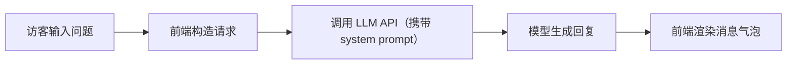

# 个人主页 v1 原型 PRD

## 1. 产品概述

JJ 的个人主页，集成数字分身聊天功能，用于向朋友、合作伙伴、面试官展示个人信息和项目经历。访客可以通过数字分身快速了解 JJ 的背景、作品和联系方式。

- **核心目标**：建立个人品牌展示入口，用数字分身降低沟通成本
- **目标用户**：朋友、潜在合作伙伴、面试官
- **v1 定位**：结构清晰、能用、可预览的最小版本

---

## 2. 核心功能

### 2.1 用户角色

| 角色 | 注册方式 | 核心权限 |
|------|----------|----------|
| 访客 | 无需注册 | 浏览主页、与数字分身对话 |

### 2.2 功能模块

1. **首屏展示区**：头像、名字、一句话介绍
2. **个人信息区**：当前在做的事、兴趣方向、个人特点
3. **数字分身聊天区**：可提问的对话界面，模拟 JJ 的语气回答问题

### 2.3 页面详情

| 页面名称 | 模块名称 | 功能描述 |
|----------|----------|----------|
| 主页 | 首屏展示区 | 展示头像、名字「JJ」、一句话介绍「一个探索AI开发的研发」 |
| 主页 | 个人信息区 | 展示当前在做的事、兴趣方向、个人特点等信息卡片 |
| 主页 | 数字分身聊天区 | 输入框 + 消息列表，支持发送问题并获取 AI 回复 |

---

## 3. 核心流程

### 3.1 访客浏览流程

访客打开页面 → 看到首屏个人介绍 → 向下滚动查看更多信息 → 找到数字分身聊天区 → 输入问题提问 → 获得 AI 回复

### 3.2 数字分身对话流程

---

## 4. 用户界面设计

### 4.1 设计风格

- **主色调**：深蓝色（#1e3a5f 或类似）+ 白色，科技感但克制
- **整体感觉**：简约、清爽、稍微有一点科技感
- **排版风格**：信息层次清楚，不要花哨
- **按钮风格**：圆角矩形，深蓝色填充，hover 有轻微反馈
- **字体**：现代无衬线字体，易读优先
- **图标风格**：简洁线性图标

### 4.2 页面设计概览

| 页面名称 | 模块名称 | UI 元素 |
|----------|----------|---------|
| 主页 | 首屏展示区 | 居中布局，圆形头像，大字号名字，副标题一句话介绍，微动画入场 |
| 主页 | 个人信息区 | 卡片式布局，2-3 个信息卡片，图标 + 标题 + 描述 |
| 主页 | 数字分身聊天区 | 固定在右下角的悬浮聊天按钮，点击展开聊天窗口，消息气泡样式 |

### 4.3 响应式设计

- **桌面端优先**，适配移动端
- 移动端：单列布局，聊天窗口全屏或底部弹窗
- 触摸优化：按钮尺寸 ≥ 44px，输入框适配手机键盘

---

## 5. v1 范围约束

### 5.1 v1 包含

- 个人信息静态展示
- 数字分身聊天界面（UI + 交互）
- 响应式布局（桌面 + 手机）
- 模拟聊天数据（接入真实 API 可后续配置）

### 5.2 v1 不包含

- 用户系统（登录/注册）
- 对话历史保存
- 多页面路由
- 后端服务
- 真实 API 接入（预留接口，先用模拟数据）
