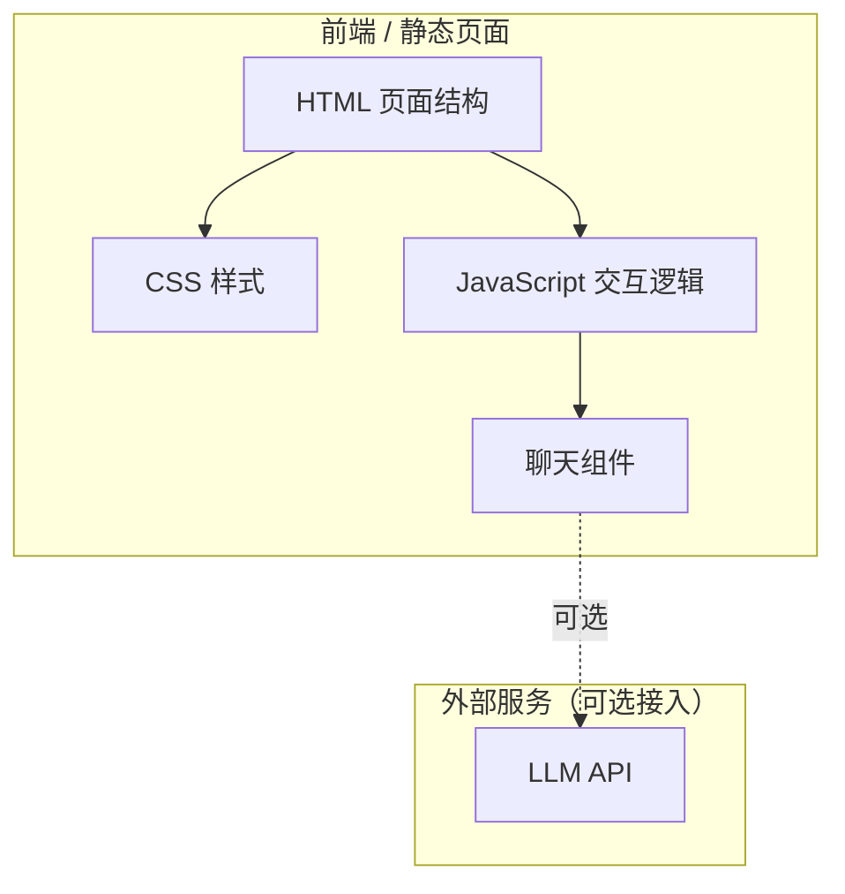

# 个人主页 v1 技术架构文档

## 1. 架构设计



**说明**：v1 为纯静态页面，无后端服务。数字分身聊天功能预留 API 接口，v1 先用模拟数据演示交互。

---

## 2. 技术选型说明

| 层级 | 技术选择 | 选择理由 |
|------|----------|----------|
| 页面结构 | 原生 HTML5 | v1 简单页面，无需框架，降低复杂度 |
| 样式 | 原生 CSS3 + CSS 变量 | 足够实现设计需求，便于后续理解和修改 |
| 交互 | 原生 JavaScript (ES6+) | 轻量，无构建步骤，双击即可打开预览 |
| 部署 | 静态托管（EdgeOne Pages 等） | 纯静态资源，任何静态托管平台均可部署 |

**为什么不用 React/Vue？**
- v1 是单页面原型，框架带来的复杂度 > 收益
- 纯 HTML 双击就能打开，零配置预览
- 符合 vibeVibe 基础篇「先跑通闭环」的理念
- 后续迭代可平滑升级到框架

---

## 3. 文件结构

```
baseDemo/
├── index.html          # 主页面
├── css/
│   └── style.css       # 样式文件
├── js/
│   └── chat.js         # 聊天逻辑
├── images/             # 图片资源（头像等）
└── .trae/
    └── documents/      # 项目文档
```

---

## 4. 聊天组件设计

### 4.1 数据结构

```javascript
// 消息对象
{
  id: "唯一标识",
  role: "user" | "assistant",  // 发送者角色
  content: "消息内容",
  timestamp: Date.now()
}
```

### 4.2 System Prompt（数字分身人设）

```
你是 JJ 的数字分身，一个探索AI开发的研发。

关于 JJ：
- 名字：JJ
- 身份：探索 AI 开发的研发
- 现在主要在做：探索 AI Agent 开发范式，记录项目学习笔记，打磨个人项目，探索独立开发者路径
- 兴趣：AI 应用、小程序与游戏开发
- 特点：喜欢把复杂问题讲成人话

说话方式：
- 语气自然、真诚
- 尽量简洁，说人话
- 不要太官方、太机械

边界：
- 只回答和 JJ 相关的问题
- 不知道的就诚实说不知道，不要编造
- 不要假装是 JJ 本人，要明确自己是数字分身
```

### 4.3 v1 模拟模式

v1 先用预设的问答对模拟对话，不接真实 API：

```javascript
// 预设问答对
const presetResponses = {
  "你现在在做什么？": "我最近主要在探索 AI Agent 开发范式，一边记录项目学习笔记，一边打磨一些有用的个人项目，在尝试独立开发者的路径。",
  "你有哪些作品？": "目前还在积累中，主要是一些 AI 相关的小项目和学习笔记，后续会陆续整理出来～",
  "怎么联系你？": "可以通过邮箱联系我，或者在主页的联系方式里找到我。"
};
```

---

## 5. 后续扩展路径

| 阶段 | 改动 | 说明 |
|------|------|------|
| v1.1 | 接入真实 LLM API | 把模拟聊天换成真实 API 调用，用环境变量存 Key |
| v1.2 | 加后端代理 | 用 Node.js 写个简单后端，保护 API Key |
| v2.0 | 升级到 React | 功能复杂后迁移到框架，方便维护 |
| v2.1 | 加数据库 | 存对话历史、用户数据 |
